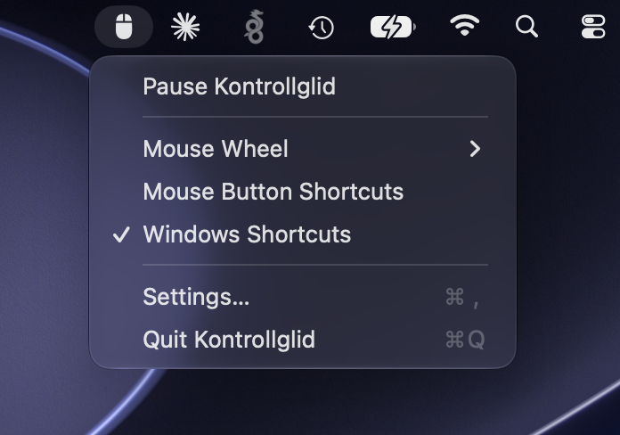
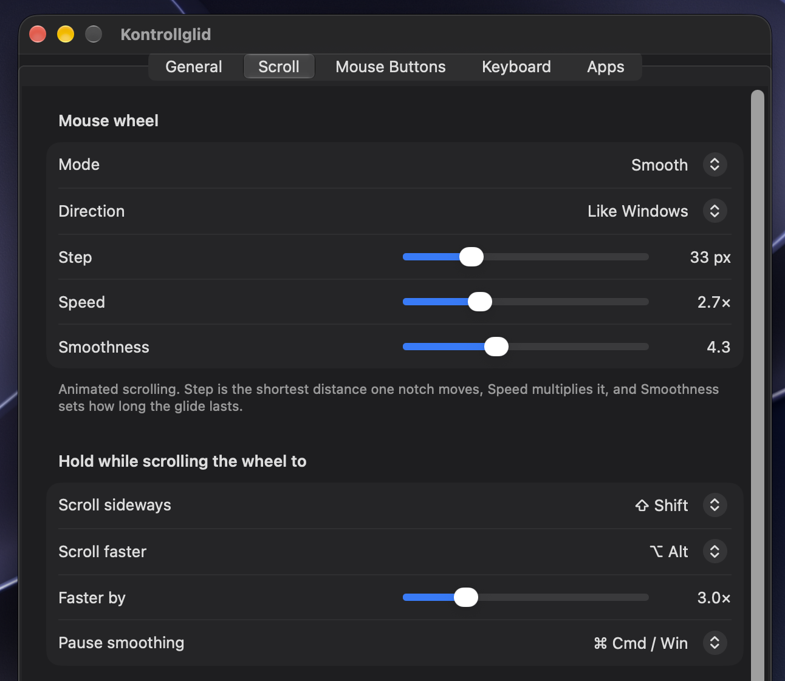
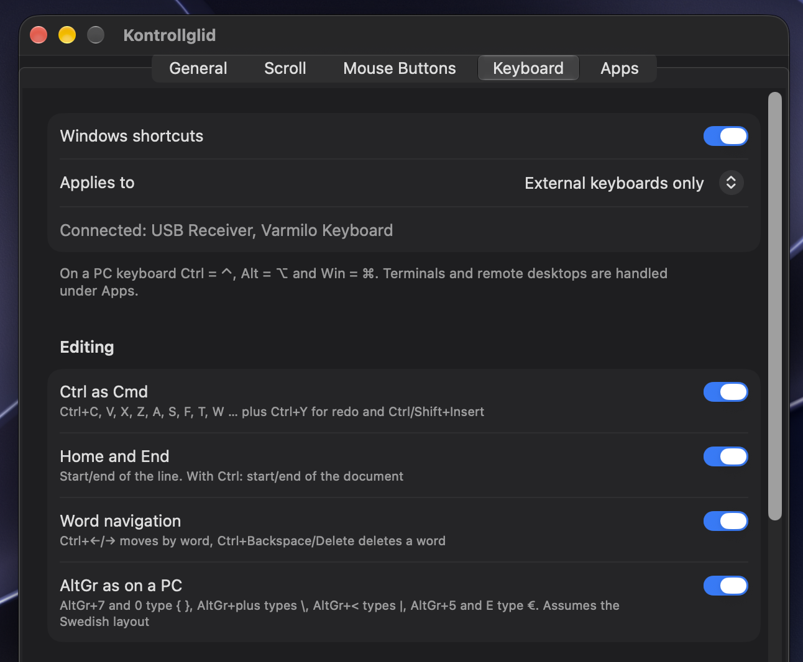

# Kontrollglid

A macOS menu bar app for people who are used to Windows. The name is Swedish for "control glide":

- **Glide:** better scrolling for ordinary mouse wheels, and extra mouse buttons as shortcuts.
- **Control:** Windows keyboard shortcuts on an external PC keyboard.

No network code, no dependencies, no telemetry. Settings stay on your Mac. Requires macOS 14 or later.





## Mouse and trackpad

- **Wheel modes:** smooth (animated, with adjustable step, speed and smoothness), no acceleration (a fixed number of lines per notch, without the sluggish start macOS has), or macOS default.
- **Direction:** set separately for mouse wheel and trackpad: follow macOS, like Windows, or natural.
- **Modifiers:** hold Shift to scroll sideways, Alt to scroll faster, Cmd to pause smoothing. All three can be changed.
- **Extra buttons:** assign middle, back, forward and other buttons to any key combination. Unassigned buttons reach the app untouched, so back and forward keep working where the app supports them.





Everything can be paused from the menu bar menu.

Three-finger swipes follow the macOS "Natural scrolling" setting, which the app cannot change. For natural gestures and a Windows-style wheel, turn that setting on and set the mouse wheel to "Like Windows".

## Keyboard

On a PC keyboard Ctrl is ⌃, Alt is ⌥ and Win is ⌘.

| You press | macOS receives | Effect |
| --- | --- | --- |
| Ctrl + letter or digit | ⌘ + same key | Copy, paste, undo, save, find … |
| Ctrl+Y | ⇧⌘Z | Redo |
| Ctrl+Insert / Shift+Insert | ⌘C / ⌘V | Copy / paste |
| Home / End | ⌘← / ⌘→ | Start / end of the line |
| Ctrl+Home / Ctrl+End | ⌘↑ / ⌘↓ | Start / end of the document |
| Ctrl+← / Ctrl+→ | ⌥← / ⌥→ | Move by word |
| Ctrl+Backspace / Ctrl+Delete | ⌥⌫ / ⌥⌦ | Delete a word |
| Alt+Tab | ⌘⇥ | Switch app |
| Alt+F4 / Ctrl+F4 | ⌘Q / ⌘W | Quit app / close window or tab |
| F5 | ⌘R | Reload |
| Print Screen | ⇧⌘5 | Screenshot tool |
| Win+L | ⌃⌘Q | Lock the screen |
| Win+E | | Open Finder |
| Win+← / Win+→ | ⌃← / ⌃→ | Switch desktop (hold Win to step several) |
| Win+↑ / Win+↓ | ⌃↑ / ⌃↓ | Mission Control / the app's windows |
| Win+Shift+← / Win+Shift+→ | | Move the window to the display on the left / right |
| F2 / Delete (Finder only) | ↩ / ⌘⌫ | Rename / move to the Trash |

Add Shift to the navigation keys to select text.

**AltGr** types the characters printed on a Swedish PC keyboard: AltGr+7 `{`, AltGr+0 `}`, AltGr+plus `\`, AltGr+< `|`, AltGr+5 or AltGr+E `€`. This assumes the macOS Swedish layout.





Every group of shortcuts can be turned off. By default only external keyboards are translated, so the built-in keyboard keeps working the Mac way.

### Per-app modes

| Mode | Behaviour | Default for |
| --- | --- | --- |
| Translate | All rules apply. | Everything else |
| Terminal mode | Ctrl is left alone, so Ctrl+C still interrupts. Home/End go to the start/end of the line. Alt+Tab, Win keys and AltGr keep working. | Terminal, iTerm, Ghostty, Warp, kitty, Alacritty |
| Off | Nothing is translated. | Windows App, Parallels, VMware Fusion, UTM |

Smooth scrolling can also be turned off per app.

### Key tester

The Keyboard tab shows the key code the app receives, which keyboard it came from and what it would be translated to. Use it when a shortcut does not behave as expected.

## Permissions

- **Accessibility:** required to read and change scroll, button and key events.
- **Input Monitoring:** only used to tell an external keyboard from the built-in one. Not needed if you choose "All keyboards".

## Build and install

Requires Xcode and [XcodeGen](https://github.com/yonaskolb/XcodeGen) (`brew install xcodegen`).

```bash
./scripts/install.sh
```

This builds a Release version, copies it to `/Applications` and starts it. To work in Xcode, run `xcodegen generate` and open `Kontrollglid.xcodeproj`.

**Signing:** the default is ad-hoc signing, which makes macOS ask for the Accessibility permission again after every build. To avoid that, copy `Config/Local.xcconfig.example` to `Config/Local.xcconfig` (ignored by git) and enter your Apple developer team ID.

Run the tests:

```bash
xcodebuild -project Kontrollglid.xcodeproj -scheme Kontrollglid -derivedDataPath build test
```

## Code layout

| Folder | Contents |
| --- | --- |
| `Kontrollglid/Logic` | Translation rules, scroll smoothing and the settings model. No system dependencies; covered by unit tests. |
| `Kontrollglid/Engine` | Event taps for scrolling, mouse buttons and keys, and keyboard identification through IOKit HID. |
| `Kontrollglid/App`, `Kontrollglid/UI` | Menu bar, settings window and storage. |

## Background

The idea for the mouse features comes from [Mos](https://github.com/Caldis/Mos). Kontrollglid is written from scratch and shares no code with Mos.

## License

MIT, see [LICENSE](LICENSE).
